Weather Prediction
================
Trevor Okinda
2024

- [Student Details](#student-details)
- [Setup Chunk](#setup-chunk)
  - [Source:](#source)
  - [Reference:](#reference)
- [Understanding the Dataset (Exploratory Data Analysis
  (EDA))](#understanding-the-dataset-exploratory-data-analysis-eda)
  - [Loading the Dataset](#loading-the-dataset)
  - [Measures of Frequency](#measures-of-frequency)
  - [Measures of Central Tendency](#measures-of-central-tendency)
  - [Measures of Distribution](#measures-of-distribution)
  - [Measures of Relationship](#measures-of-relationship)
  - [ANOVA](#anova)
  - [Plots](#plots)
- [Preprocessing and Data
  Transformation](#preprocessing-and-data-transformation)
  - [Missing Values](#missing-values)
- [Training Model](#training-model)
  - [Data Splitting](#data-splitting)
  - [Bootstrapping](#bootstrapping)
  - [Model Training](#model-training)
  - [Performance Comparison](#performance-comparison)
- [Saving Model](#saving-model)

# Student Details

|                       |                    |
|-----------------------|--------------------|
| **Student ID Number** | 134780             |
| **Student Name**      | Trevor Okinda      |
| **BBIT 4.2 Group**    | C                  |
| **Project Name**      | Weather Prediction |

# Setup Chunk

**Note:** the following KnitR options have been set as the global
defaults: <BR>
`knitr::opts_chunk$set(echo = TRUE, warning = FALSE, eval = TRUE, collapse = FALSE, tidy = TRUE)`.

More KnitR options are documented here
<https://bookdown.org/yihui/rmarkdown-cookbook/chunk-options.html> and
here <https://yihui.org/knitr/options/>.

### Source:

The dataset that was used can be downloaded here: *\<<a
href="https://www.kaggle.com/datasets/zaraavagyan/weathercsv/discussion\"
class="uri">https://www.kaggle.com/datasets/zaraavagyan/weathercsv/discussion\</a>\>*

### Reference:

*\<Avagyan, Z. (2017). Weather CSV \[Data set\]. Kaggle.
<a href="https://www.kaggle.com/datasets/zaraavagyan/weathercsv\"
class="uri">https://www.kaggle.com/datasets/zaraavagyan/weathercsv\</a>\>  
Refer to the APA 7th edition manual for rules on how to cite datasets:
<https://apastyle.apa.org/style-grammar-guidelines/references/examples/data-set-references>*

# Understanding the Dataset (Exploratory Data Analysis (EDA))

## Loading the Dataset

``` r
# Load necessary library
library(readr)

# Load dataset
weather_data <- read.csv("seattle-weather.csv", colClasses = c(
  precipitation = "numeric",
  temp_max = "numeric",
  temp_min = "numeric",
  wind = "numeric",
  weather = "factor"
))

# Display the structure of the dataset
str(weather_data)
```

    ## 'data.frame':    1461 obs. of  5 variables:
    ##  $ precipitation: num  0 10.9 0.8 20.3 1.3 2.5 0 0 4.3 1 ...
    ##  $ temp_max     : num  12.8 10.6 11.7 12.2 8.9 4.4 7.2 10 9.4 6.1 ...
    ##  $ temp_min     : num  5 2.8 7.2 5.6 2.8 2.2 2.8 2.8 5 0.6 ...
    ##  $ wind         : num  4.7 4.5 2.3 4.7 6.1 2.2 2.3 2 3.4 3.4 ...
    ##  $ weather      : Factor w/ 5 levels "drizzle","fog",..: 1 3 3 3 3 3 3 5 3 3 ...

``` r
# View the first few rows of the dataset
head(weather_data)
```

    ##   precipitation temp_max temp_min wind weather
    ## 1           0.0     12.8      5.0  4.7 drizzle
    ## 2          10.9     10.6      2.8  4.5    rain
    ## 3           0.8     11.7      7.2  2.3    rain
    ## 4          20.3     12.2      5.6  4.7    rain
    ## 5           1.3      8.9      2.8  6.1    rain
    ## 6           2.5      4.4      2.2  2.2    rain

``` r
# View the dataset in a separate viewer window
View(weather_data)
```

## Measures of Frequency

``` r
# Measures of Frequency

# Frequency distribution of the 'weather' column
weather_frequency <- table(weather_data$weather)
print(weather_frequency)
```

    ## 
    ## drizzle     fog    rain    snow     sun 
    ##      53     101     641      26     640

``` r
# Proportions of the 'weather' column
weather_proportions <- prop.table(weather_frequency)
print(weather_proportions)
```

    ## 
    ##    drizzle        fog       rain       snow        sun 
    ## 0.03627652 0.06913073 0.43874059 0.01779603 0.43805613

## Measures of Central Tendency

``` r
# Measures of Central Tendency

# Mean
mean_precipitation <- mean(weather_data$precipitation, na.rm = TRUE)
mean_temp_max <- mean(weather_data$temp_max, na.rm = TRUE)
mean_temp_min <- mean(weather_data$temp_min, na.rm = TRUE)
mean_wind <- mean(weather_data$wind, na.rm = TRUE)

# Median
median_precipitation <- median(weather_data$precipitation, na.rm = TRUE)
median_temp_max <- median(weather_data$temp_max, na.rm = TRUE)
median_temp_min <- median(weather_data$temp_min, na.rm = TRUE)
median_wind <- median(weather_data$wind, na.rm = TRUE)

# Mode function (there can be more than one mode)
get_mode <- function(v) {
  uniqv <- unique(v)
  uniqv[which.max(tabulate(match(v, uniqv)))]
}

mode_precipitation <- get_mode(weather_data$precipitation)
mode_temp_max <- get_mode(weather_data$temp_max)
mode_temp_min <- get_mode(weather_data$temp_min)
mode_wind <- get_mode(weather_data$wind)

# Print the results
list(
  mean_precipitation = mean_precipitation,
  median_precipitation = median_precipitation,
  mode_precipitation = mode_precipitation,
  mean_temp_max = mean_temp_max,
  median_temp_max = median_temp_max,
  mode_temp_max = mode_temp_max,
  mean_temp_min = mean_temp_min,
  median_temp_min = median_temp_min,
  mode_temp_min = mode_temp_min,
  mean_wind = mean_wind,
  median_wind = median_wind,
  mode_wind = mode_wind
)
```

    ## $mean_precipitation
    ## [1] 3.029432
    ## 
    ## $median_precipitation
    ## [1] 0
    ## 
    ## $mode_precipitation
    ## [1] 0
    ## 
    ## $mean_temp_max
    ## [1] 16.43908
    ## 
    ## $median_temp_max
    ## [1] 15.6
    ## 
    ## $mode_temp_max
    ## [1] 11.1
    ## 
    ## $mean_temp_min
    ## [1] 8.234771
    ## 
    ## $median_temp_min
    ## [1] 8.3
    ## 
    ## $mode_temp_min
    ## [1] 6.1
    ## 
    ## $mean_wind
    ## [1] 3.241136
    ## 
    ## $median_wind
    ## [1] 3
    ## 
    ## $mode_wind
    ## [1] 2.6

## Measures of Distribution

``` r
# Measures of Distribution
library(e1071)

# Range
range_precipitation <- range(weather_data$precipitation, na.rm = TRUE)
range_temp_max <- range(weather_data$temp_max, na.rm = TRUE)
range_temp_min <- range(weather_data$temp_min, na.rm = TRUE)
range_wind <- range(weather_data$wind, na.rm = TRUE)

# Variance
variance_precipitation <- var(weather_data$precipitation, na.rm = TRUE)
variance_temp_max <- var(weather_data$temp_max, na.rm = TRUE)
variance_temp_min <- var(weather_data$temp_min, na.rm = TRUE)
variance_wind <- var(weather_data$wind, na.rm = TRUE)

# Standard Deviation
sd_precipitation <- sd(weather_data$precipitation, na.rm = TRUE)
sd_temp_max <- sd(weather_data$temp_max, na.rm = TRUE)
sd_temp_min <- sd(weather_data$temp_min, na.rm = TRUE)
sd_wind <- sd(weather_data$wind, na.rm = TRUE)

# Skewness
skewness_precipitation <- skewness(weather_data$precipitation, na.rm = TRUE)
skewness_temp_max <- skewness(weather_data$temp_max, na.rm = TRUE)
skewness_temp_min <- skewness(weather_data$temp_min, na.rm = TRUE)
skewness_wind <- skewness(weather_data$wind, na.rm = TRUE)

# Kurtosis
kurtosis_precipitation <- kurtosis(weather_data$precipitation, na.rm = TRUE)
kurtosis_temp_max <- kurtosis(weather_data$temp_max, na.rm = TRUE)
kurtosis_temp_min <- kurtosis(weather_data$temp_min, na.rm = TRUE)
kurtosis_wind <- kurtosis(weather_data$wind, na.rm = TRUE)

# Print the results
list(
  range_precipitation = range_precipitation,
  variance_precipitation = variance_precipitation,
  sd_precipitation = sd_precipitation,
  skewness_precipitation = skewness_precipitation,
  kurtosis_precipitation = kurtosis_precipitation,
  range_temp_max = range_temp_max,
  variance_temp_max = variance_temp_max,
  sd_temp_max = sd_temp_max,
  skewness_temp_max = skewness_temp_max,
  kurtosis_temp_max = kurtosis_temp_max,
  range_temp_min = range_temp_min,
  variance_temp_min = variance_temp_min,
  sd_temp_min = sd_temp_min,
  skewness_temp_min = skewness_temp_min,
  kurtosis_temp_min = kurtosis_temp_min,
  range_wind = range_wind,
  variance_wind = variance_wind,
  sd_wind = sd_wind,
  skewness_wind = skewness_wind,
  kurtosis_wind = kurtosis_wind
)
```

    ## $range_precipitation
    ## [1]  0.0 55.9
    ## 
    ## $variance_precipitation
    ## [1] 44.625
    ## 
    ## $sd_precipitation
    ## [1] 6.680194
    ## 
    ## $skewness_precipitation
    ## [1] 3.498449
    ## 
    ## $kurtosis_precipitation
    ## [1] 15.43973
    ## 
    ## $range_temp_max
    ## [1] -1.6 35.6
    ## 
    ## $variance_temp_max
    ## [1] 54.01894
    ## 
    ## $sd_temp_max
    ## [1] 7.349758
    ## 
    ## $skewness_temp_max
    ## [1] 0.2803534
    ## 
    ## $kurtosis_temp_max
    ## [1] -0.6953684
    ## 
    ## $range_temp_min
    ## [1] -7.1 18.3
    ## 
    ## $variance_temp_min
    ## [1] 25.23057
    ## 
    ## $sd_temp_min
    ## [1] 5.023004
    ## 
    ## $skewness_temp_min
    ## [1] -0.2489466
    ## 
    ## $kurtosis_temp_min
    ## [1] -0.605904
    ## 
    ## $range_wind
    ## [1] 0.4 9.5
    ## 
    ## $variance_wind
    ## [1] 2.067341
    ## 
    ## $sd_wind
    ## [1] 1.437825
    ## 
    ## $skewness_wind
    ## [1] 0.8898374
    ## 
    ## $kurtosis_wind
    ## [1] 0.7919119

## Measures of Relationship

``` r
# Measures of Relationship

# Correlation matrix for numeric columns
correlation_matrix <- cor(weather_data[, c("precipitation", "temp_max", "temp_min", "wind")], use = "complete.obs")
print(correlation_matrix)
```

    ##               precipitation   temp_max    temp_min        wind
    ## precipitation    1.00000000 -0.2285548 -0.07268404  0.32804509
    ## temp_max        -0.22855482  1.0000000  0.87568666 -0.16485663
    ## temp_min        -0.07268404  0.8756867  1.00000000 -0.07418523
    ## wind             0.32804509 -0.1648566 -0.07418523  1.00000000

``` r
# Scatter plot matrix to visualize relationships
pairs(weather_data[, c("precipitation", "temp_max", "temp_min", "wind")], 
      main = "Scatter Plot Matrix",
      col = weather_data$weather)
```

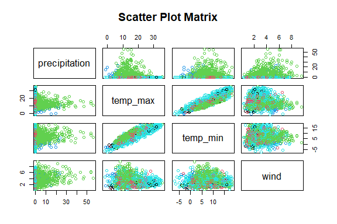<!-- -->

## ANOVA

``` r
# Perform ANOVA for precipitation across different weather types
anova_precipitation <- aov(precipitation ~ weather, data = weather_data)
summary(anova_precipitation)
```

    ##               Df Sum Sq Mean Sq F value Pr(>F)    
    ## weather        4  16061    4015   119.1 <2e-16 ***
    ## Residuals   1456  49092      34                   
    ## ---
    ## Signif. codes:  0 '***' 0.001 '**' 0.01 '*' 0.05 '.' 0.1 ' ' 1

``` r
# Perform ANOVA for temp_max across different weather types
anova_temp_max <- aov(temp_max ~ weather, data = weather_data)
summary(anova_temp_max)
```

    ##               Df Sum Sq Mean Sq F value Pr(>F)    
    ## weather        4  16301    4075   94.84 <2e-16 ***
    ## Residuals   1456  62566      43                   
    ## ---
    ## Signif. codes:  0 '***' 0.001 '**' 0.01 '*' 0.05 '.' 0.1 ' ' 1

``` r
# Perform ANOVA for temp_min across different weather types
anova_temp_min <- aov(temp_min ~ weather, data = weather_data)
summary(anova_temp_min)
```

    ##               Df Sum Sq Mean Sq F value Pr(>F)    
    ## weather        4   2829   707.3   30.28 <2e-16 ***
    ## Residuals   1456  34007    23.4                   
    ## ---
    ## Signif. codes:  0 '***' 0.001 '**' 0.01 '*' 0.05 '.' 0.1 ' ' 1

``` r
# Perform ANOVA for wind across different weather types
anova_wind <- aov(wind ~ weather, data = weather_data)
summary(anova_wind)
```

    ##               Df Sum Sq Mean Sq F value Pr(>F)    
    ## weather        4  304.1   76.02   40.78 <2e-16 ***
    ## Residuals   1456 2714.2    1.86                   
    ## ---
    ## Signif. codes:  0 '***' 0.001 '**' 0.01 '*' 0.05 '.' 0.1 ' ' 1

``` r
# Post-hoc test for precipitation
tukey_precipitation <- TukeyHSD(anova_precipitation)
print(tukey_precipitation)
```

    ##   Tukey multiple comparisons of means
    ##     95% family-wise confidence level
    ## 
    ## Fit: aov(formula = precipitation ~ weather, data = weather_data)
    ## 
    ## $weather
    ##                       diff        lwr       upr     p adj
    ## fog-drizzle   1.428627e-14  -2.689913  2.689913 1.0000000
    ## rain-drizzle  6.557878e+00   4.291204  8.824553 0.0000000
    ## snow-drizzle  8.553846e+00   4.756630 12.351063 0.0000000
    ## sun-drizzle  -7.474105e-15  -2.266810  2.266810 1.0000000
    ## rain-fog      6.557878e+00   4.860070  8.255687 0.0000000
    ## snow-fog      8.553846e+00   5.066212 12.041480 0.0000000
    ## sun-fog      -2.176037e-14  -1.697989  1.697989 1.0000000
    ## snow-rain     1.995968e+00  -1.176693  5.168629 0.4229482
    ## sun-rain     -6.557878e+00  -7.444079 -5.671678 0.0000000
    ## sun-snow     -8.553846e+00 -11.726604 -5.381089 0.0000000

``` r
# Post-hoc test for temp_max
tukey_temp_max <- TukeyHSD(anova_temp_max)
print(tukey_temp_max)
```

    ##   Tukey multiple comparisons of means
    ##     95% family-wise confidence level
    ## 
    ## Fit: aov(formula = temp_max ~ weather, data = weather_data)
    ## 
    ## $weather
    ##                     diff        lwr         upr     p adj
    ## fog-drizzle    0.8310106  -2.205707  3.86772780 0.9451936
    ## rain-drizzle  -2.4718129  -5.030725  0.08709932 0.0641456
    ## snow-drizzle -10.3533382 -14.640122 -6.06655477 0.0000000
    ## sun-drizzle    3.9354599   1.376395  6.49452480 0.0002733
    ## rain-fog      -3.3028236  -5.219527 -1.38612042 0.0000272
    ## snow-fog     -11.1843488 -15.121636 -7.24706154 0.0000000
    ## sun-fog        3.1044493   1.187542  5.02135622 0.0001020
    ## snow-rain     -7.8815253 -11.463230 -4.29982010 0.0000000
    ## sun-rain       6.4072728   5.406816  7.40772922 0.0000000
    ## sun-snow      14.2887981  10.706984 17.87061231 0.0000000

``` r
# Post-hoc test for temp_min
tukey_temp_min <- TukeyHSD(anova_temp_min)
print(tukey_temp_min)
```

    ##   Tukey multiple comparisons of means
    ##     95% family-wise confidence level
    ## 
    ## Fit: aov(formula = temp_min ~ weather, data = weather_data)
    ## 
    ## $weather
    ##                    diff          lwr       upr     p adj
    ## fog-drizzle   0.8678872  -1.37094424  3.106719 0.8275676
    ## rain-drizzle  0.4774468  -1.40912109  2.364015 0.9584250
    ## snow-drizzle -6.9651669 -10.12561447 -3.804719 0.0000000
    ## sun-drizzle   2.2324292   0.34574880  4.119110 0.0110122
    ## rain-fog     -0.3904404  -1.80353714  1.022656 0.9433188
    ## snow-fog     -7.8330541 -10.73583427 -4.930274 0.0000000
    ## sun-fog       1.3645421  -0.04870495  2.777789 0.0643415
    ## snow-rain    -7.4426137 -10.08323962 -4.801988 0.0000000
    ## sun-rain      1.7549824   1.01739212  2.492573 0.0000000
    ## sun-snow      9.1975962   6.55688983 11.838302 0.0000000

``` r
# Post-hoc test for wind
tukey_wind <- TukeyHSD(anova_wind)
print(tukey_wind)
```

    ##   Tukey multiple comparisons of means
    ##     95% family-wise confidence level
    ## 
    ## Fit: aov(formula = wind ~ weather, data = weather_data)
    ## 
    ## $weather
    ##                    diff          lwr        upr     p adj
    ## fog-drizzle   0.1132636 -0.519233033  0.7457602 0.9883817
    ## rain-drizzle  1.3019663  0.768988298  1.8349442 0.0000000
    ## snow-drizzle  2.0436139  1.150749735  2.9364781 0.0000000
    ## sun-drizzle   0.5884817  0.055471954  1.1214915 0.0219259
    ## rain-fog      1.1887027  0.789485956  1.5879194 0.0000000
    ## snow-fog      1.9303503  1.110280253  2.7504204 0.0000000
    ## sun-fog       0.4752181  0.075958958  0.8744773 0.0103367
    ## snow-rain     0.7416477 -0.004360705  1.4876560 0.0522237
    ## sun-rain     -0.7134845 -0.921862627 -0.5051065 0.0000000
    ## sun-snow     -1.4551322 -2.201163301 -0.7091011 0.0000011

## Plots

``` r
library(ggplot2)
# Boxplot for precipitation
ggplot(weather_data, aes(x = weather, y = precipitation)) +
  geom_boxplot() +
  labs(title = "Precipitation by Weather Type", x = "Weather", y = "Precipitation")
```

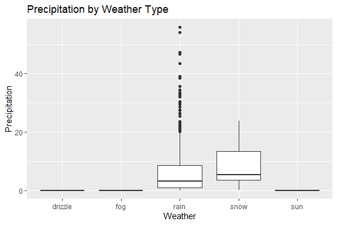<!-- -->

``` r
# Boxplot for temp_max
ggplot(weather_data, aes(x = weather, y = temp_max)) +
  geom_boxplot() +
  labs(title = "Max Temperature by Weather Type", x = "Weather", y = "Max Temperature")
```

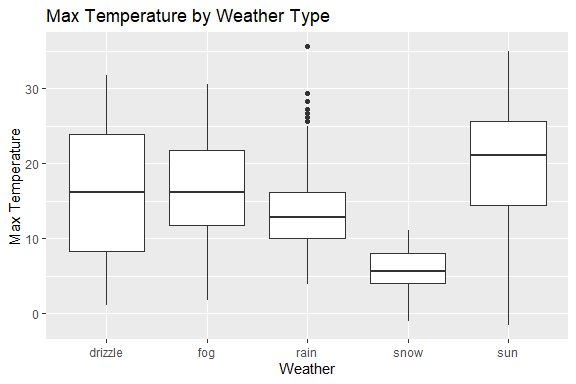<!-- -->

``` r
# Boxplot for temp_min
ggplot(weather_data, aes(x = weather, y = temp_min)) +
  geom_boxplot() +
  labs(title = "Min Temperature by Weather Type", x = "Weather", y = "Min Temperature")
```

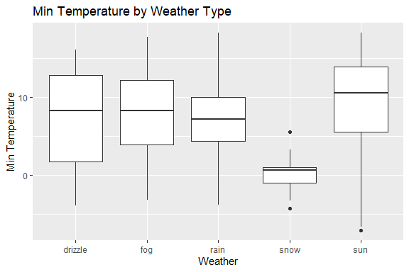<!-- -->

``` r
# Boxplot for wind
ggplot(weather_data, aes(x = weather, y = wind)) +
  geom_boxplot() +
  labs(title = "Wind Speed by Weather Type", x = "Weather", y = "Wind Speed")
```

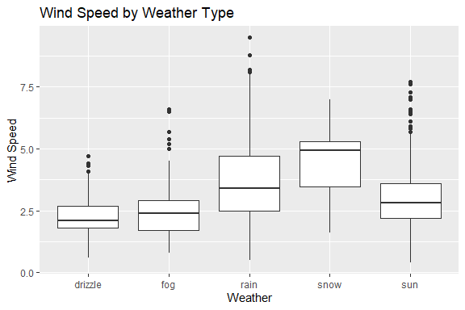<!-- -->

``` r
# Load necessary libraries
library(ggplot2)
library(dplyr)
```

    ## 
    ## Attaching package: 'dplyr'

    ## The following objects are masked from 'package:stats':
    ## 
    ##     filter, lag

    ## The following objects are masked from 'package:base':
    ## 
    ##     intersect, setdiff, setequal, union

``` r
# Histogram for precipitation
ggplot(weather_data, aes(x = precipitation)) +
  geom_histogram(binwidth = 1, fill = "blue", color = "black") +
  labs(title = "Histogram of Precipitation", x = "Precipitation", y = "Frequency")
```

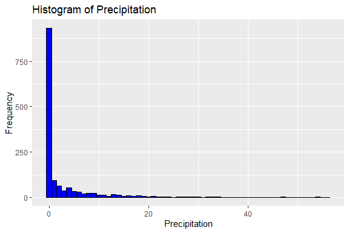<!-- -->

``` r
# Histogram for temp_max
ggplot(weather_data, aes(x = temp_max)) +
  geom_histogram(binwidth = 1, fill = "red", color = "black") +
  labs(title = "Histogram of Max Temperature", x = "Max Temperature", y = "Frequency")
```

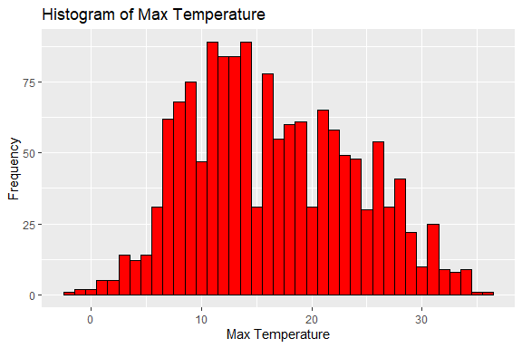<!-- -->

``` r
# Histogram for temp_min
ggplot(weather_data, aes(x = temp_min)) +
  geom_histogram(binwidth = 1, fill = "green", color = "black") +
  labs(title = "Histogram of Min Temperature", x = "Min Temperature", y = "Frequency")
```

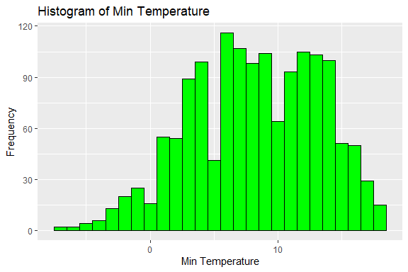<!-- -->

``` r
# Histogram for wind
ggplot(weather_data, aes(x = wind)) +
  geom_histogram(binwidth = 1, fill = "purple", color = "black") +
  labs(title = "Histogram of Wind Speed", x = "Wind Speed", y = "Frequency")
```

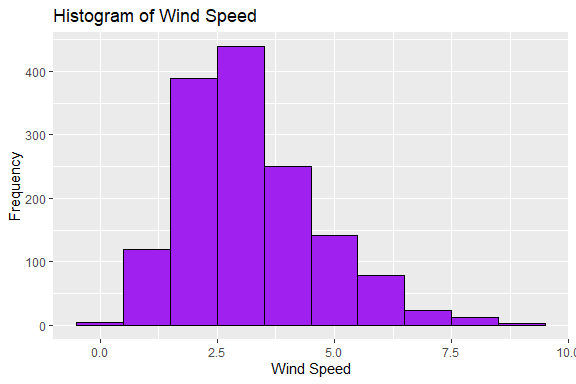<!-- -->

``` r
# Boxplot for precipitation
ggplot(weather_data, aes(x = "", y = precipitation)) +
  geom_boxplot(fill = "blue") +
  labs(title = "Boxplot of Precipitation", x = "", y = "Precipitation")
```

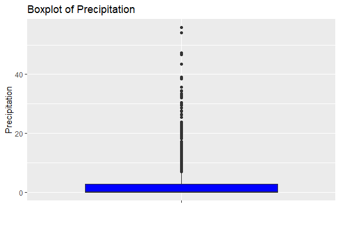<!-- -->

``` r
# Boxplot for temp_max
ggplot(weather_data, aes(x = "", y = temp_max)) +
  geom_boxplot(fill = "red") +
  labs(title = "Boxplot of Max Temperature", x = "", y = "Max Temperature")
```

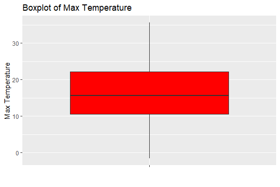<!-- -->

``` r
# Boxplot for temp_min
ggplot(weather_data, aes(x = "", y = temp_min)) +
  geom_boxplot(fill = "green") +
  labs(title = "Boxplot of Min Temperature", x = "", y = "Min Temperature")
```

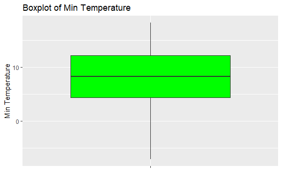<!-- -->

``` r
# Boxplot for wind
ggplot(weather_data, aes(x = "", y = wind)) +
  geom_boxplot(fill = "purple") +
  labs(title = "Boxplot of Wind Speed", x = "", y = "Wind Speed")
```

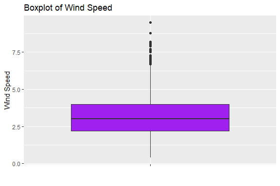<!-- -->

``` r
# Scatter plot for temp_max vs temp_min
ggplot(weather_data, aes(x = temp_min, y = temp_max, color = weather)) +
  geom_point() +
  labs(title = "Scatter Plot of Max Temp vs Min Temp", x = "Min Temperature", y = "Max Temperature")
```

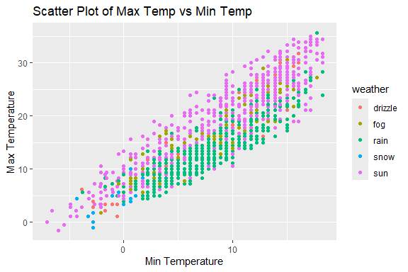<!-- -->

``` r
# Scatter plot for temp_max vs wind
ggplot(weather_data, aes(x = wind, y = temp_max, color = weather)) +
  geom_point() +
  labs(title = "Scatter Plot of Max Temp vs Wind", x = "Wind Speed", y = "Max Temperature")
```

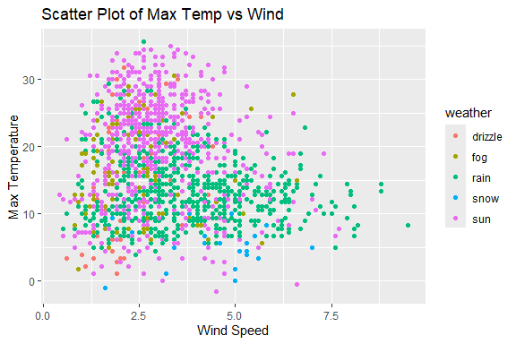<!-- -->

``` r
# Scatter plot for precipitation vs wind
ggplot(weather_data, aes(x = wind, y = precipitation, color = weather)) +
  geom_point() +
  labs(title = "Scatter Plot of Precipitation vs Wind", x = "Wind Speed", y = "Precipitation")
```

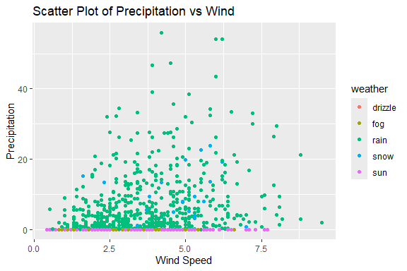<!-- -->

``` r
# Install and load GGally if not already installed
if (!require(GGally)) install.packages("GGally")
```

    ## Loading required package: GGally

    ## Registered S3 method overwritten by 'GGally':
    ##   method from   
    ##   +.gg   ggplot2

``` r
library(GGally)

# Pair plot for all numeric variables
ggpairs(weather_data, columns = c("precipitation", "temp_max", "temp_min", "wind"), 
        mapping = aes(color = weather),
        title = "Pair Plot of Weather Data")
```

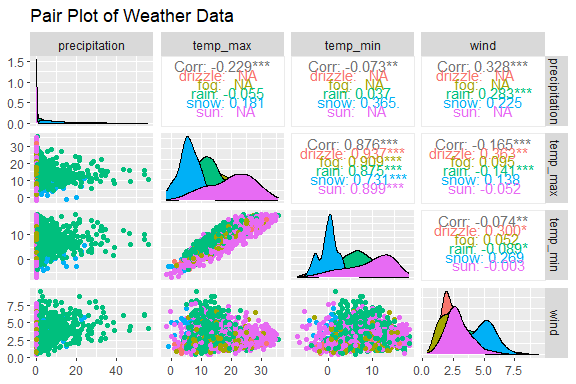<!-- -->

# Preprocessing and Data Transformation

## Missing Values

``` r
# Check for missing values in each column
missing_values_per_column <- colSums(is.na(weather_data))
print(missing_values_per_column)
```

    ## precipitation      temp_max      temp_min          wind       weather 
    ##             0             0             0             0             0

``` r
# Check for any missing values in the entire dataset
total_missing_values <- sum(is.na(weather_data))
print(total_missing_values)
```

    ## [1] 0

``` r
# Percentage of missing values in each column
missing_values_percentage <- colSums(is.na(weather_data)) / nrow(weather_data) * 100
print(missing_values_percentage)
```

    ## precipitation      temp_max      temp_min          wind       weather 
    ##             0             0             0             0             0

# Training Model

## Data Splitting

``` r
library(caret)
```

    ## Loading required package: lattice

``` r
# Set seed for reproducibility
set.seed(123)

# Split data into training (70%) and testing (30%) sets
train_index <- createDataPartition(weather_data$weather, p = 0.7, list = FALSE)
train_data <- weather_data[train_index, ]
test_data <- weather_data[-train_index, ]

# Display the dimensions of the training and testing sets
dim(train_data)
```

    ## [1] 1025    5

``` r
dim(test_data)
```

    ## [1] 436   5

## Bootstrapping

``` r
library(boot)
```

    ## 
    ## Attaching package: 'boot'

    ## The following object is masked from 'package:lattice':
    ## 
    ##     melanoma

``` r
# Set seed for reproducibility
set.seed(123)

# Define a function for bootstrapping
boot_fn <- function(data, indices) {
  d <- data[indices, ]  # Select bootstrap sample
  fit <- lm(precipitation ~ temp_max + temp_min + wind, data = d)
  return(coef(fit))
}

# Perform bootstrapping with 1000 replicates
bootstrap_results <- boot(data = train_data, statistic = boot_fn, R = 1000)

# Print bootstrap results
print(bootstrap_results)
```

    ## 
    ## ORDINARY NONPARAMETRIC BOOTSTRAP
    ## 
    ## 
    ## Call:
    ## boot(data = train_data, statistic = boot_fn, R = 1000)
    ## 
    ## 
    ## Bootstrap Statistics :
    ##       original       bias    std. error
    ## t1*  2.6950719 -0.024523242  0.61728429
    ## t2* -0.5303853  0.002657600  0.04865904
    ## t3*  0.6022406 -0.003801126  0.07695239
    ## t4*  1.2773653  0.003088898  0.18269042

## Model Training

``` r
library(randomForest)
```

    ## randomForest 4.7-1.1

    ## Type rfNews() to see new features/changes/bug fixes.

    ## 
    ## Attaching package: 'randomForest'

    ## The following object is masked from 'package:dplyr':
    ## 
    ##     combine

    ## The following object is masked from 'package:ggplot2':
    ## 
    ##     margin

``` r
library(e1071) # SVM package

# Set seed for reproducibility
set.seed(123)

# Define a train control object for k-fold cross-validation
train_control <- trainControl(method = "cv", number = 10)

# Train a model using cross-validation
model <- train(precipitation ~ temp_max + temp_min + wind, data = train_data,
               method = "lm", trControl = train_control)

# Print cross-validation results
print(model)
```

    ## Linear Regression 
    ## 
    ## 1025 samples
    ##    3 predictor
    ## 
    ## No pre-processing
    ## Resampling: Cross-Validated (10 fold) 
    ## Summary of sample sizes: 922, 922, 923, 923, 922, 923, ... 
    ## Resampling results:
    ## 
    ##   RMSE      Rsquared  MAE     
    ##   5.877866  0.20341   3.632718
    ## 
    ## Tuning parameter 'intercept' was held constant at a value of TRUE

``` r
# Set seed for reproducibility
set.seed(123)

# Define train control for cross-validation
train_control <- trainControl(method = "cv", number = 10)

# Train a decision tree model
dt_model <- train(weather ~ ., data = train_data, method = "rpart", trControl = train_control)

# Print the model summary
print(dt_model)
```

    ## CART 
    ## 
    ## 1025 samples
    ##    4 predictor
    ##    5 classes: 'drizzle', 'fog', 'rain', 'snow', 'sun' 
    ## 
    ## No pre-processing
    ## Resampling: Cross-Validated (10 fold) 
    ## Summary of sample sizes: 922, 923, 922, 922, 921, 923, ... 
    ## Resampling results across tuning parameters:
    ## 
    ##   cp           Accuracy   Kappa    
    ##   0.002025463  0.8439409  0.7269920
    ##   0.009548611  0.8459398  0.7290217
    ##   0.722222222  0.5914484  0.2723661
    ## 
    ## Accuracy was used to select the optimal model using the largest value.
    ## The final value used for the model was cp = 0.009548611.

``` r
# Evaluate the model on the test set
dt_predictions <- predict(dt_model, newdata = test_data)
dt_conf_matrix <- confusionMatrix(dt_predictions, test_data$weather)
print(dt_conf_matrix)
```

    ## Confusion Matrix and Statistics
    ## 
    ##           Reference
    ## Prediction drizzle fog rain snow sun
    ##    drizzle       0   0    0    0   0
    ##    fog           0   0    0    0   0
    ##    rain          0   0  180    7   0
    ##    snow          0   0    0    0   0
    ##    sun          15  30   12    0 192
    ## 
    ## Overall Statistics
    ##                                           
    ##                Accuracy : 0.8532          
    ##                  95% CI : (0.8165, 0.8851)
    ##     No Information Rate : 0.4404          
    ##     P-Value [Acc > NIR] : < 2.2e-16       
    ##                                           
    ##                   Kappa : 0.7377          
    ##                                           
    ##  Mcnemar's Test P-Value : NA              
    ## 
    ## Statistics by Class:
    ## 
    ##                      Class: drizzle Class: fog Class: rain Class: snow
    ## Sensitivity                  0.0000    0.00000      0.9375     0.00000
    ## Specificity                  1.0000    1.00000      0.9713     1.00000
    ## Pos Pred Value                  NaN        NaN      0.9626         NaN
    ## Neg Pred Value               0.9656    0.93119      0.9518     0.98394
    ## Prevalence                   0.0344    0.06881      0.4404     0.01606
    ## Detection Rate               0.0000    0.00000      0.4128     0.00000
    ## Detection Prevalence         0.0000    0.00000      0.4289     0.00000
    ## Balanced Accuracy            0.5000    0.50000      0.9544     0.50000
    ##                      Class: sun
    ## Sensitivity              1.0000
    ## Specificity              0.7664
    ## Pos Pred Value           0.7711
    ## Neg Pred Value           1.0000
    ## Prevalence               0.4404
    ## Detection Rate           0.4404
    ## Detection Prevalence     0.5711
    ## Balanced Accuracy        0.8832

``` r
# Set seed for reproducibility
set.seed(123)

# Train a random forest model
rf_model <- train(weather ~ ., data = train_data, method = "rf", trControl = train_control)

# Print the model summary
print(rf_model)
```

    ## Random Forest 
    ## 
    ## 1025 samples
    ##    4 predictor
    ##    5 classes: 'drizzle', 'fog', 'rain', 'snow', 'sun' 
    ## 
    ## No pre-processing
    ## Resampling: Cross-Validated (10 fold) 
    ## Summary of sample sizes: 922, 923, 922, 922, 921, 923, ... 
    ## Resampling results across tuning parameters:
    ## 
    ##   mtry  Accuracy   Kappa    
    ##   2     0.8322233  0.7116524
    ##   3     0.8292629  0.7079557
    ##   4     0.8263503  0.7044384
    ## 
    ## Accuracy was used to select the optimal model using the largest value.
    ## The final value used for the model was mtry = 2.

``` r
# Evaluate the model on the test set
rf_predictions <- predict(rf_model, newdata = test_data)
rf_conf_matrix <- confusionMatrix(rf_predictions, test_data$weather)
print(rf_conf_matrix)
```

    ## Confusion Matrix and Statistics
    ## 
    ##           Reference
    ## Prediction drizzle fog rain snow sun
    ##    drizzle       2   0    0    0   3
    ##    fog           0   4    0    0  11
    ##    rain          1   0  178    4   1
    ##    snow          0   0    2    3   0
    ##    sun          12  26   12    0 177
    ## 
    ## Overall Statistics
    ##                                           
    ##                Accuracy : 0.8349          
    ##                  95% CI : (0.7966, 0.8685)
    ##     No Information Rate : 0.4404          
    ##     P-Value [Acc > NIR] : < 2.2e-16       
    ##                                           
    ##                   Kappa : 0.7162          
    ##                                           
    ##  Mcnemar's Test P-Value : NA              
    ## 
    ## Statistics by Class:
    ## 
    ##                      Class: drizzle Class: fog Class: rain Class: snow
    ## Sensitivity                0.133333   0.133333      0.9271    0.428571
    ## Specificity                0.992874   0.972906      0.9754    0.995338
    ## Pos Pred Value             0.400000   0.266667      0.9674    0.600000
    ## Neg Pred Value             0.969838   0.938242      0.9444    0.990719
    ## Prevalence                 0.034404   0.068807      0.4404    0.016055
    ## Detection Rate             0.004587   0.009174      0.4083    0.006881
    ## Detection Prevalence       0.011468   0.034404      0.4220    0.011468
    ## Balanced Accuracy          0.563104   0.553120      0.9512    0.711955
    ##                      Class: sun
    ## Sensitivity              0.9219
    ## Specificity              0.7951
    ## Pos Pred Value           0.7797
    ## Neg Pred Value           0.9282
    ## Prevalence               0.4404
    ## Detection Rate           0.4060
    ## Detection Prevalence     0.5206
    ## Balanced Accuracy        0.8585

``` r
# Set seed for reproducibility
set.seed(123)

# Define train control for cross-validation
train_control <- trainControl(method = "cv", number = 10)

# Train an SVM model
svm_model <- train(weather ~ ., data = train_data, method = "svmRadial", trControl = train_control)

# Print the model summary
print(svm_model)
```

    ## Support Vector Machines with Radial Basis Function Kernel 
    ## 
    ## 1025 samples
    ##    4 predictor
    ##    5 classes: 'drizzle', 'fog', 'rain', 'snow', 'sun' 
    ## 
    ## No pre-processing
    ## Resampling: Cross-Validated (10 fold) 
    ## Summary of sample sizes: 922, 923, 922, 922, 921, 923, ... 
    ## Resampling results across tuning parameters:
    ## 
    ##   C     Accuracy   Kappa    
    ##   0.25  0.7599281  0.5731512
    ##   0.50  0.7648026  0.5826320
    ##   1.00  0.7785285  0.6077213
    ## 
    ## Tuning parameter 'sigma' was held constant at a value of 0.4999642
    ## Accuracy was used to select the optimal model using the largest value.
    ## The final values used for the model were sigma = 0.4999642 and C = 1.

``` r
# Evaluate the model on the test set
svm_predictions <- predict(svm_model, newdata = test_data)
svm_conf_matrix <- confusionMatrix(svm_predictions, test_data$weather)
print(svm_conf_matrix)
```

    ## Confusion Matrix and Statistics
    ## 
    ##           Reference
    ## Prediction drizzle fog rain snow sun
    ##    drizzle       0   0    0    0   0
    ##    fog           0   0    2    0   0
    ##    rain          1   1  153    4  15
    ##    snow          0   0    0    2   0
    ##    sun          14  29   37    1 177
    ## 
    ## Overall Statistics
    ##                                           
    ##                Accuracy : 0.7615          
    ##                  95% CI : (0.7186, 0.8007)
    ##     No Information Rate : 0.4404          
    ##     P-Value [Acc > NIR] : < 2.2e-16       
    ##                                           
    ##                   Kappa : 0.5765          
    ##                                           
    ##  Mcnemar's Test P-Value : NA              
    ## 
    ## Statistics by Class:
    ## 
    ##                      Class: drizzle Class: fog Class: rain Class: snow
    ## Sensitivity                  0.0000   0.000000      0.7969    0.285714
    ## Specificity                  1.0000   0.995074      0.9139    1.000000
    ## Pos Pred Value                  NaN   0.000000      0.8793    1.000000
    ## Neg Pred Value               0.9656   0.930876      0.8511    0.988479
    ## Prevalence                   0.0344   0.068807      0.4404    0.016055
    ## Detection Rate               0.0000   0.000000      0.3509    0.004587
    ## Detection Prevalence         0.0000   0.004587      0.3991    0.004587
    ## Balanced Accuracy            0.5000   0.497537      0.8554    0.642857
    ##                      Class: sun
    ## Sensitivity              0.9219
    ## Specificity              0.6680
    ## Pos Pred Value           0.6860
    ## Neg Pred Value           0.9157
    ## Prevalence               0.4404
    ## Detection Rate           0.4060
    ## Detection Prevalence     0.5917
    ## Balanced Accuracy        0.7950

## Performance Comparison

``` r
# Compare model performance using resamples
model_comparison <- resamples(list(DecisionTree = dt_model, RandomForest = rf_model, SVM = svm_model))

# Summarize results
summary(model_comparison)
```

    ## 
    ## Call:
    ## summary.resamples(object = model_comparison)
    ## 
    ## Models: DecisionTree, RandomForest, SVM 
    ## Number of resamples: 10 
    ## 
    ## Accuracy 
    ##                   Min.   1st Qu.    Median      Mean   3rd Qu.      Max. NA's
    ## DecisionTree 0.7961165 0.8280667 0.8480392 0.8459398 0.8640777 0.8811881    0
    ## RandomForest 0.7745098 0.8159774 0.8284314 0.8322233 0.8491100 0.8834951    0
    ## SVM          0.7058824 0.7597087 0.7854083 0.7785285 0.8010044 0.8235294    0
    ## 
    ## Kappa 
    ##                   Min.   1st Qu.    Median      Mean   3rd Qu.      Max. NA's
    ## DecisionTree 0.6455841 0.6979293 0.7304434 0.7290217 0.7599144 0.7924658    0
    ## RandomForest 0.6119107 0.6850935 0.7043455 0.7116524 0.7401132 0.7972441    0
    ## SVM          0.4736842 0.5732759 0.6193952 0.6077213 0.6489585 0.6888136    0

# Saving Model

``` r
# Load the saved model
loaded_dt_model <- readRDS("./models/saved_dt_model.rds")

# Prepare new data for prediction
new_data <- data.frame(
  precipitation = 0.8,
  temp_max = 11.7,
  temp_min = 7.2,
  wind = 2.3
)

# Use the loaded model to make predictions
predictions_loaded_model <- predict(loaded_dt_model, newdata = new_data)

# Print predictions
print(predictions_loaded_model)
```

    ## [1] rain
    ## Levels: drizzle fog rain snow sun
